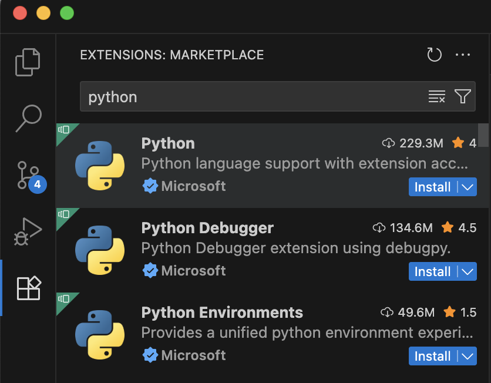
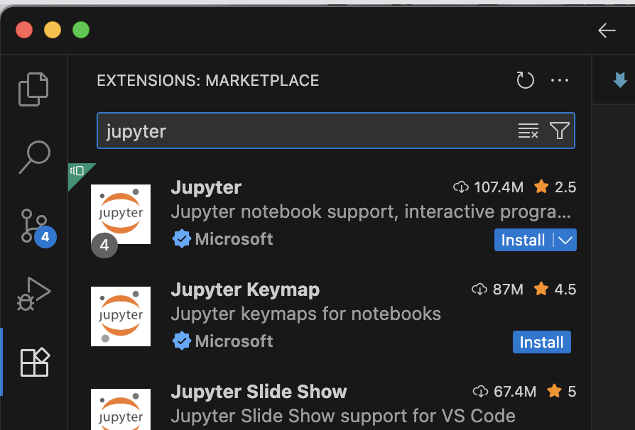

# Mobile Computing

## 1. Introduction

This course is part of the [**ETH Zurich continuing education CAS programmes**](https://mas-aid.ethz.ch/cas/cascmc.html). It is covered over three weekends and consists of two connected parts:

- **Part I:** [**276-0001-00L Wireless Data Communication HS2026**](https://www.vvz.ethz.ch/Vorlesungsverzeichnis/lerneinheit.view?lerneinheitId=204012&semkez=2026W&ansicht=LEHRVERANSTALTUNGEN&lang=en)
 - **Part II:** [**276-0003-00L Mobile Computing HS2026**](https://www.vvz.ethz.ch/Vorlesungsverzeichnis/lerneinheit.view?lerneinheitId=204014&semkez=2026W&ansicht=LEHRVERANSTALTUNGEN&lang=de)

Mobile computing, together with cloud computing and A.I., is a core digital technology that offers possibilities for interacting with the environment. As digital transformation continues across many economic sectors, the role of mobile computing has become more critical. This course equips participants with theoretical knowledge and practical insights. It is structured around fundamental and advanced concepts of wireless data communication and extends toward new approaches such as local Large Language Models (LLMs). As a scientific discipline, mobile computing extends its reach across diverse sectors as it is inherently interdisciplinary, integrating elements of software engineering, hardware design, security, algorithms, and user experience to create solutions that are intuitive and helpful.

<mark><strong>Consumer products</strong></mark>, mobile phones, wireless networks, sensors, and location tags used in everyday life often rely on digital technology with low-cost, resource-constrained, and battery-powered devices. In addition, emergency services and public and military applications underscore the sensitivity of mobile computing. Devices and systems designed for these purposes are built with rigorous specifications for security, reliability, and robustness, often pioneering innovations that later find civilian applications.

In <mark><strong>mobile and autonomous systems</strong></mark>, connected vehicles, unmanned aerial vehicles (UAVs), robots, and humanoid robots use wireless communication, sensors, positioning, and local computing to exchange information and interact with their surroundings. Related technologies are also used in factories and logistics for automation and tracking.

In <mark><strong>medical technology</strong></mark>, mobile computing supports applications such as wearable devices, monitoring of vital signs, remote diagnostics, and digital healthcare workflows.

In the <mark><strong>financial sector</strong></mark>, mobile devices can be used as digital wallets for payments and for storing, sending, and receiving cryptocurrencies.

Mobile computing offers insights into how data and services are consumed and delivered, while <mark><strong>cloud computing</strong></mark> provides the infrastructure and services necessary for supporting these mobile functionalities at scale. Mobile devices often face limitations in storage capacity and processing power. This is where cloud computing comes into play, offering vast storage spaces and powerful computational resources on demand. By offloading heavy processing tasks to the cloud, mobile devices can operate more efficiently and undertake more complex applications without degrading performance. The integration of cloud computing enhances the functionality of mobile applications by enabling features such as data synchronization, backup, and access to advanced analytics.

### 1.1 Mobile Computing and Artificial Intelligence

Exploring the use of Artificial Intelligence (A.I.) in mobile computing provides a window into the current state of digital technology. As A.I. technologies continue to evolve, the integration of Large Language Models (LLMs) into mobile systems promises new possibilities: devices that are not only connected, but also adaptive, context-aware, and capable of assisting users in increasingly sophisticated ways. We call this exciting new concept <mark><strong>Mobile A.I.</strong></mark>. Systems with Mobile A.I. can use data generated by mobile devices to improve decision-making, solve complex control problems in cooperation with other systems, personalize user experiences, and optimize system performance.

In consumer applications, A.I. already enhances mobile devices through features such as predictive text, voice recognition, image processing, translation, and system resource management. These capabilities make devices more responsive to individual needs and preferences. Mobile A.I. processing takes place directly on the device rather than exclusively in a centralized cloud. Local processing can enable faster responses, offline functionality, lower communication costs, and stronger privacy protections, since sensitive data may not need to leave the device.

At the same time, Mobile A.I. with local LLMs introduces new risks. A model running on a mobile device may generate harmful, misleading, biased, or unlawful content without the same oversight mechanisms that cloud-based systems can provide. It may also be harder to monitor, update, audit, or restrict once deployed. Mobile A.I. embedded in mobile computing therefore raises important ethical, privacy, and security concerns. Systems must be designed to protect user data, respect privacy, and follow sound data-handling practices. Just as importantly, developers must consider not only what information goes into a local LLM, but also what actions, decisions, and outputs it is allowed to produce.

### 1.2 Course Outline

#### 1.2.1 Part I: Wireless Data Communication

<details><summary>01 - Understanding Data</summary>

The course begins with the fundamentals of data representation, delving into how information is encoded, compressed, and optimized for transmission. This focus topic not only lays the groundwork for understanding the technical aspects of mobile computing but also introduces concepts like entropy and redundancy, which are pivotal in developing efficient data handling strategies, especially in A.I.-driven applications.

 - Analog and digital representation
 - Binary data, sampling
 - Information, entropy, redundancy, compression
 - Time series, correlation, pattern detection

</details>

<details><summary>02 - Data Modulation and Communication</summary>

As the course progresses, the focus shifts to the basics of data modulation and signal processing, which are essential for sending information over a communication medium such as the air. We examine modulation schemes such as QPSK and x-QAM, framed within the context of their real-world applications. Networking forms the backbone of mobile computing. We further explore the physical layer of wireless communication, including wave propagation and the challenges posed by noise and interference.

 - How data is handled (packaging, queueing, source encoding/decoding)
 - Carrying data over wireless links (signal modulation, channel coding schemes)
 - AM / FM modulation, QPSK and x-QAM modulation
 - Noise and Shannon capacity
 - Physics and the radio / optical frequency spectrum
 - Basics of wave propagation, signal strength, noise and interference
 - Multi-user MIMO, intelligent reconfigurable surfaces

</details>


<details><summary>03 - Emerging Technologies</summary>

From the evolution of Wi-Fi and Bluetooth standards to the transformative impact of 5G and beyond in industries like automotive and IoT, this focus topic connects each technological advancement to its practical use. A section on satellite communications shows how data connectivity is being extended to remote corners of the globe. Understanding the regulatory landscape is crucial. This focus topic provides a deep dive into the global and regional organizations responsible for spectrum management, helping participants navigate the complexities of standardization and radio spectrum allocation - a knowledge area critical for working with wireless and mobile computing technologies.

 - Evolution of Wi-Fi standards (IEEE 802.11) and Bluetooth (BLE)
 - Cellular networking, 5G
 - Satellite-based communication and navigation systems
 - Global and regional spectrum management (ITU, FCC)
 - Allocation of spectrum for various technologies (Wi-Fi, cellular, satellite)

</details>

#### 1.2.2 Part II: Mobile Computing

<details><summary>04 - Specialized Applications</summary>

Practical applications in designing devices for entertainment, healthcare, and emergency scenarios are covered in this focus topic, emphasizing how mobile computing is integral to innovation and efficiency in these fields. From interactive toys using visible light communication to advanced medical devices like automated insulin pumps, this part illustrates the critical role of mobile computing in driving technological solutions. We will also explore how mobile systems can be used in remote and challenged areas. Use cases in underdeveloped regions for mobile empowerment and humanitarian activities (relief and rescue in war, conflict, and natural disasters) are discussed. We explore how concepts like mesh networking and delay-tolerant networking can help users remain connected and able to use digital technologies.

- Visible light communication (VLC) for toys and consumer products
- Audio communication for cinemas, media, and toys
- Medical auto-injectors and closed-loop automated insulin pumps with a PID controller
- Delay-tolerant and mesh networking in challenged regions (South Africa, humanitarian aid)
</details>


<details><summary>05 - Mobile A.I.</summary>

The focus topic examines the deployment of local large language models (LLMs) on mobile devices, offering a forward-looking perspective on how mobile computing is evolving to incorporate A.I. capabilities directly on devices and paving the way for smarter, more responsive technology. Participants are invited to develop their own mobile computing algorithms with the help of LLMs, addressing the need for fair and cooperative distributed decision-making when Wi-Fi devices compete for radio resources.

 - Adaptive control of systems, and behavior
 - Local LLMs on resource-constrained mobile devices
 - Hands-on LLM notebooks covering prompting, embeddings, attention, inference control, local deployment, and building a micro-LLM
 - First-order logic, game theory, decision-making algorithms


</details>

<details><summary>06 - Cloud Computing</summary>

Mobile and cloud computing are connected through data, services, and infrastructure. This focus topic examines how cloud resources support storage, synchronization, computation, and A.I. processing at scale.

 - Cloud-backed services
 - Offloading computation from mobile devices to cloud infrastructure

</details>


## 2. Set Up for the Mobile Computing Course

Please allocate approximately half an hour to prepare your computer with the software tools used throughout the hands-on exercises. This guide presents each installation as a sequence of discrete steps, and every step concludes with a short verification that confirms the installation succeeded. No prior programming experience is required. Please complete the steps in the order presented.


| Step | Component | Purpose | Time |
|:----:|-----------|---------|:----:|
| 1 | Git | Retrieve the course material and receive subsequent updates | ~5 min |
| 2 | Python | The programming language in which the notebooks are executed | ~5 min |
| 3 | Java (JDK) | Required by several of the wireless-network laboratories | ~5 min |
| 4 | Visual Studio Code | The editor used to open and execute the notebooks | ~5 min |
| 5 | Jupyter extension | Enables Visual Studio Code to open and run interactive notebooks | ~5 min |
| 6 | Moodle | Access the course and submit exercises | ~2 min |
| 7 | Course material | Download the notebooks to the local machine | ~2 min |
|   |   | Total | ~30 min |

Each step depends on the preceding one, so please complete them in sequence.


### 2.1 Install Git

Git is used to download the course material and to track updates released during the course. ETH operates its own Git server at [gitlab.ethz.ch](https://gitlab.ethz.ch); no account is required to download the material.

1. Navigate to [git-scm.com/downloads](https://git-scm.com/downloads).
2. Download the release corresponding to your operating system (Windows or macOS).
3. Run the installer and retain the default settings.
4. Close any open terminal window and open a new one. A newly installed tool becomes available only in terminals opened after the installation completes.

To confirm the installation, open a new terminal and run:

```bash
git --version
```

A version number should be displayed, for example `git version 2.45.0`.


### 2.2 Install Python

Python is the programming language in which the notebooks are written.

1. Navigate to [python.org/downloads](https://www.python.org/downloads/).
2. Download Python 3.11 or a later release.
3. Run the installer. On Windows, select the option **Add Python to PATH** on the first screen; this option is easily overlooked but essential.
4. Close any open terminal window and open a new one so that the installation is recognised.

To confirm the installation, open a new terminal and run:

```bash
python --version
```

The output should read `Python 3.11` or higher. On macOS, if the `python` command is not found, use `python3 --version` instead.


### 2.3 Install Java (JDK)

Several of the wireless-network laboratories compile short Java programs, so the Java Development Kit (JDK) is required.

1. Navigate to [adoptium.net](https://adoptium.net/), which provides a free, open-source distribution of Java.
2. Download the most recent LTS release (for example, Java 21) for your operating system.
3. Run the installer and retain the default settings. On Windows, permit the installer to add Java to the PATH if prompted.

> Optional alternative for macOS: users of [Homebrew](https://brew.sh) may instead run `brew install temurin`.

To confirm the installation, run the following two commands in your terminal:

```bash
java -version
javac -version
```

The first command reports the Java runtime, the second the Java compiler. Both are required, and both should display a version number, such as `openjdk version "21.0.2"` and `javac 21.0.2`.


### 2.4 Install Visual Studio Code

Visual Studio Code is the editor used to open and execute the notebooks.

1. Navigate to [code.visualstudio.com](https://code.visualstudio.com/).
2. Download the release for your operating system (Windows or macOS).
3. Install it using the default settings.

To confirm the installation, launch Visual Studio Code; it should display its Welcome screen.


### 2.5 Install the Jupyter extension in Visual Studio Code

Extensions add functionality to Visual Studio Code. The Python and Jupyter extensions are required in order to open the notebooks.

1. Open Visual Studio Code.
2. Select the Extensions icon in the left-hand sidebar (the four-squares icon).
3. Search for "Python" and select Install.
4. Search for "Jupyter" and select Install.


<p align="center">
  
</p>

<p align="center">
  
</p>


5. Open a new terminal and run the command below. It installs `ipykernel`, the component that runs the code inside a notebook.

   ```bash
   python -m pip install ipykernel
   ```

   On macOS, use `python3 -m pip install ipykernel` if the `python` command is not found.

To confirm the installation, verify that both extensions are listed under "Installed" in the Extensions panel, and that the terminal reports a version number for:

```bash
python -m ipykernel --version
```


### 2.6 Check Your Moodle Access

Moodle is used to provide course information and submit exercises.

1. Open the [course Moodle page](https://moodle-app2.let.ethz.ch/course/view.php?id=28441) in a web browser and log in using your ETH credentials.
2. Verify that you can access the course and its assignment activities (German: "Aufgaben").

Use the corresponding Moodle assignment activity to upload each assignment. Follow the [submission guidelines](../03_Assignments/Submission-Guidelines.md) for file naming and other requirements.


### 2.7 Download the Course Material

First determine the location on your computer at which the course material should be stored, for example the `Documents` folder. Git downloads the material into the folder in which the terminal is currently positioned, so this location must be selected first.

1. In the terminal, navigate to the chosen folder. For example, to use the Documents folder:

   ```bash
   cd Documents
   ```

   Replace `Documents` with any preferred folder.

2. Download the notebooks and lecture files:

   ```bash
   git clone --depth 1 https://gitlab.ethz.ch/wireless/MobileComputing.git
   ```

   This creates a folder named `MobileComputing`, within the selected location, that contains all course files.

3. Open Visual Studio Code, select File, then Open Folder, and choose the `MobileComputing` folder you just downloaded. The course folders `01_Lectures`, `02_Notebooks`, and `03_Assignments` should now be visible in the Explorer panel on the left. You are ready to begin.


### 2.8 Verify the Setup

As a final check, open the verification notebook to confirm that the environment is correctly configured.

1. In the Explorer panel, navigate to `02_Notebooks/00_Intro/` and open `00.1_Check_Course_Environment.ipynb`.
2. When prompted, select the installed Python interpreter (top-right of the notebook).
3. Execute the cells in order. The notebook examines each component of the setup and reports any that are missing.

If a problem occurs:

- If the `python` command is not recognised, restart the computer after installation to refresh the PATH.
- If the notebooks do not open, verify that the Python and Jupyter extensions are installed (Step 5).
- If a notebook opens but the cells do not run, or no interpreter appears in the selection list, install `ipykernel` as described in Step 5.

## 3. Getting Help

This completes the setup. Should any difficulty arise, please contact the teaching team.
